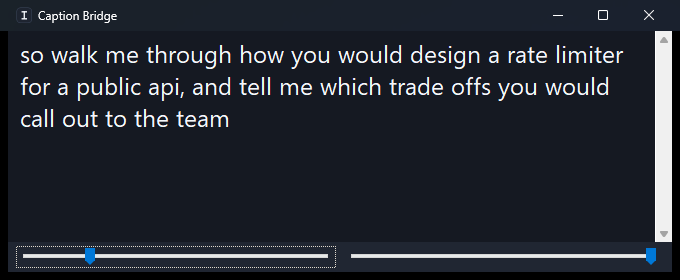

# Caption Bridge

A single-window mirror of **Windows Live Captions**. It follows the captions window as fast
as the system will report changes and shows the text in a large, read-only box you can park
anywhere on screen.



That is the whole app. There is no browser, no ChatGPT integration, no licensing, no
transcript merging, and no automatic scroll-position tracking — just the caption text, as
quickly as it can be read.

## Requirements

- Windows 10 version 1809 (build 17763) or later, 64-bit
- Windows Live Captions (Win + Ctrl + L), available on Windows 11 and recent Windows 10 builds
- .NET 8 SDK — only to build. The published exe is self-contained and needs no runtime.

## Getting the exe

```powershell
.\build\publish.ps1
```

This writes a single self-contained `publish\CaptionBridge.exe` (~74 MB) that runs on any
64-bit Windows 10/11 machine with no .NET install.

To build and test without publishing:

```powershell
dotnet build CaptionBridge.sln -c Release
dotnet test  CaptionBridge.sln -c Release
```

## Using it

1. Turn on Windows Live Captions with **Win + Ctrl + L**.
2. Start `CaptionBridge.exe`.

The window mirrors whatever Live Captions is showing and keeps itself scrolled to the newest
text. Until Live Captions is running the window explains how to turn it on, and the title bar
reads "waiting for Live Captions".

| Control | What it does |
| --- | --- |
| Left slider | Caption font size (10–48 pt) |
| Right slider | Window opacity (20–100%) |
| Ctrl + A / Ctrl + C | Select all / copy |
| Right-click | Copy, select all, clear, refresh rate, always on top, start Live Captions, exit |

The caption box is **read-only** but behaves like normal text: the mouse shows the I-beam
cursor and you can click and drag to select. While anything is selected the mirror pauses so
your selection survives, and the title bar says so; clear the selection and it catches up
immediately.

Window size, position, font size, opacity, always-on-top and refresh rate are remembered in
`%AppData%\CaptionBridge\settings.json`. Launching the exe a second time raises the window
that is already running instead of starting another copy.

## How it keeps up

The default refresh is 25 ms, and a measured end-to-end round trip from "caption text changes"
to "text visible in the window" lands around 40 ms. Three things buy that:

- The Live Captions window is found by enumerating top-level window handles, which is far
  cheaper than searching the UI Automation tree, and the handle is cached until it goes away.
- Each poll pulls the caption text in a **single** cross-process call using a UI Automation
  `CacheRequest` rather than walking the element tree property by property.
- The poll loop owns a dedicated thread and raises the system timer resolution, so a 25 ms
  sleep is actually 25 ms rather than the default ~16 ms granularity.

Redraw stays smooth because only the changed tail of the text is replaced, letting the edit
control repaint the affected lines instead of the whole box.

If your machine is busy, drop the rate with **right-click → Refresh rate**.

## Repository layout

```
src/CaptionBridge/           the application
  Program.cs                 entry point and single-instance handling
  CaptionBridgeForm.cs       the window
  Services/
    LiveCaptionReader.cs     the polling loop that mirrors Live Captions
    LiveCaptionsWindowFinder.cs
    CaptionTextCleaner.cs    strips window chrome from the raw text
    CaptionSettings.cs       settings and their JSON store
tests/CaptionBridge.Tests/   unit tests for the text cleaning
build/publish.ps1            produces the single-file exe
tools/generate-icon.ps1      regenerates the app icon
tools/verify-mirror.ps1      end-to-end check against a stand-in captions window
tools/capture-window.ps1     screenshots the window for this README
```

## Verifying a change

`tools/verify-mirror.ps1` launches the published exe against a stand-in window titled
"Live captions", feeds it phrases, and reports how long each one took to appear. It also
checks that the caption box is read-only, that the window recovers when captions disappear
and come back, and that a second launch does not start a second process.
